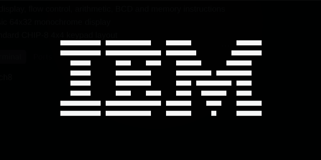

# cippotto

[](https://github.com/albhed/cippotto/actions/workflows/ci.yml)

A CHIP-8 emulator written in C (C99) with SDL2.



## Features

- Full CHIP-8 opcode set, including display, flow control, arithmetic, BCD and memory instructions
- SDL2-based rendering of the classic 64x32 monochrome display
- Keyboard input mapped to the standard CHIP-8 4x4 keypad layout
- Audio: beep output driven by the sound timer
- Delay and sound timers running at 60 Hz
- Runtime-configurable quirks, so you can match the behavior of different original interpreters without recompiling
- A real `--help` / `-h` flag describing all available options
- Quit anytime with `Esc` or by closing the window (also works with `Ctrl+C` in the terminal)

### Quirks

CHIP-8 has a handful of instructions whose exact behavior was ambiguous or
diverged between the original COSMAC VIP interpreter and later ones (like
SUPER-CHIP). This emulator defaults to the modern/common behavior, and lets
you opt into the legacy behavior per-flag:

| Flag | Affects | Behavior when enabled |
| --- | --- | --- |
| `--quirk-shift-vy` | `8XY6` / `8XYE` (shift) | Shifts `VY` instead of `VX` and stores the result in `VX` |
| `--quirk-wrap` | `DXYN` (draw sprite) | Sprites wrap around screen edges instead of being clipped |
| `--quirk-jump-vx` | `BNNN` (jump with offset) | Uses `VX` as the offset register, i.e. `BXNN` behavior |
| `--quirk-fx55-increment` | `FX55` / `FX65` (memory load/store) | Increments the `I` register as it reads/writes registers to memory |

Flags can be combined, and can be mixed with a ROM path in any order, e.g.:

```sh
./chip8 --quirk-wrap --quirk-shift-vy roms/5-quirks.ch8
```

## Build & run

Requirements: a C compiler (`gcc`), `pkg-config`, and the SDL2 development
libraries installed on your system.

```sh
make build        # builds the ./chip8 executable
./chip8 roms/1-chip8-logo.ch8
```

Run with quirk flags:

```sh
./chip8 --quirk-jump-vx --quirk-fx55-increment roms/4-flags.ch8
```

Show usage and all available flags:

```sh
./chip8 --help
```

### Controls

The original CHIP-8 keypad is mapped to the left side of a QWERTY keyboard:

```
CHIP-8          Keyboard
1 2 3 C         1 2 3 4
4 5 6 D   -->   Q W E R
7 8 9 E         A S D F
A 0 B F         Z X C V
```

## Testing

```sh
make test
```

This builds and runs the unit test suites under `test/` (covering the CPU
core, display, input, audio, the main loop and the quirks parsing/behavior),
using SDL's dummy video/audio drivers so it also runs headless/in CI.

### ROM-based validation

The `roms/` directory includes test ROMs from the
[Timendus/chip8-test-suite](https://github.com/Timendus/chip8-test-suite)
project, used to manually validate the emulator against real-world CHIP-8
test cases:

- `1-chip8-logo.ch8` / `ibm_logo.ch8` — splash screen / display sanity check
- `3-corax+.ch8` — opcode correctness tests
- `4-flags.ch8` — flag register behavior tests
- `6-keypad.ch8` — keypad input tests

These have been run and visually verified against the emulator.

`5-quirks.ch8` (the quirks test ROM from the same suite) is included as well:
the quirk flags described above are implemented and covered by unit tests,
but the ROM itself has not yet been run and verified end-to-end — that's a
pending validation step.

## License

Licensed under the GNU General Public License v3.0 — see [LICENSE](LICENSE)
for the full text.

## Credits

- Test ROMs under `roms/` (`1-chip8-logo.ch8`, `3-corax+.ch8`, `4-flags.ch8`,
  `5-quirks.ch8`, `6-keypad.ch8`) come from
  [Timendus/chip8-test-suite](https://github.com/Timendus/chip8-test-suite),
  used here for manual and automated validation.
